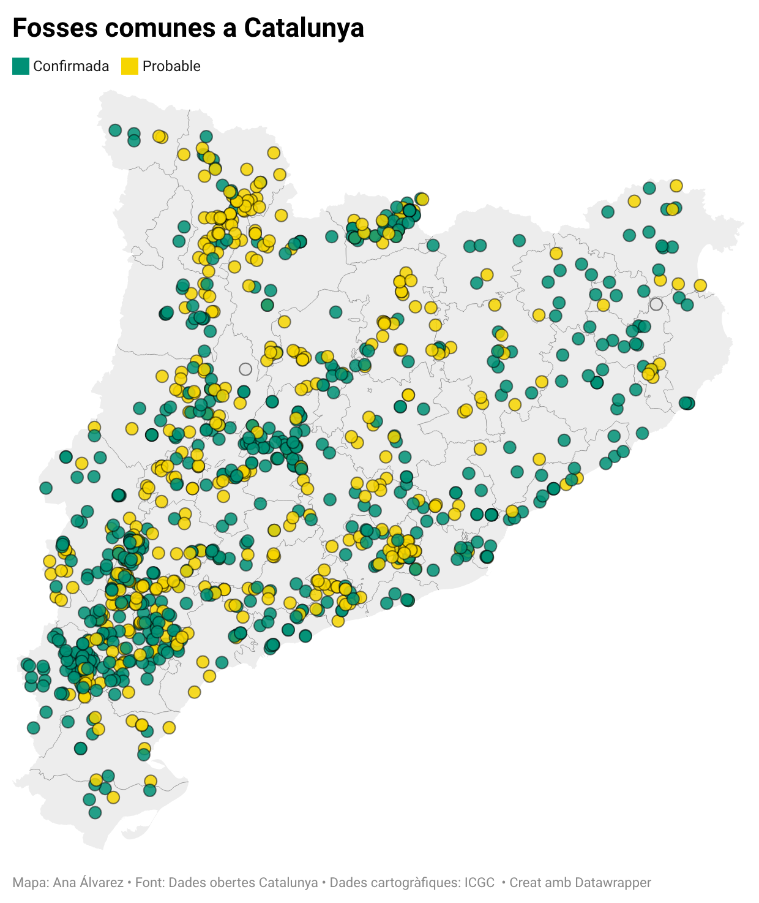

# Técnicas básicas y populares: Dot Density Map

**Fuente de los datos**: https://analisi.transparenciacatalunya.cat/Legislaci-just-cia/Fosses-comunes-a-Catalunya/6js6-vud6

**Descripción**: El mapa de fosas comunes en Cataluña geolocaliza las fosas y restos óseos hallados en superficie. Cada punto tiene asociada una ficha descriptiva con información sobre sus características y su estado de conservación y dignificación.

**Visualización:** [Acceso a gráfico interactivo](https://www.datawrapper.de/_/SQ43u/)

**Fuentes**:
- Data Viz Project: https://datavizproject.com/data-type/dot-map/
- Data Visualization Catalogue: https://datavizcatalogue.com/methods/dot_map.html

## Definición general de la técnica

El Dot Density Map (Mapa de densidad de puntos) tiene su origen en el siglo XIX. El ejemplo más célebre es el mapa del Dr. John Snow (1854), que cartografió casos de cólera en Londres para identificar que el origen del brote estaba en una fuente de agua contaminada.

Es un mapa temático que utiliza puntos para representar la presencia y distribución espacial de un fenómeno. 

Es sencillo de interpretar: muchos puntos indican alta concentración y pocos puntos, baja concentración. 

Existen dos modalidades: 
- one-to-one (cada punto = un registro) 
- one-to-many (cada punto = una cantidad determinada).

Algunos ejemplos de aplicación son los mapas de distribución de población, casos de enfermedades, localización de eventos o de recursos.

## Tipo y estructura de datos

El requisito esencial para utilizar esta técnica es contar con datos de localización (longitud/latitud o dirección geocodificable).

Los datos pueden ser cuantitativos, y entonces cada punto puede representar una cantidad (one-to-many), o cualitativos, en caso de categorías que pueden codificarse usando el color.

La modalidad one-to-one es ideal para datasets pequeños, y one-to-many para representar agregaciones en datasets grandes.

La limitación de esta técnica es que, en conjuntos muy grandes, los puntos se superponen y hacen difícil la lectura. Para paliarlo, se puede utilizar el zoom, la transparencia o la agregación de registros por punto.

## Comentario sobre la visualización

He escogido el dataset de Fosas comunes en Catalunya, disponible en el Catálogo de Datos Abiertos de Catalunya. Y he utilizado Datawrapper para la creación del mapa interactivo.

Cada punto representa una fosa, de las incluidas en el catálogo. Utilicé el color para distinguir entre dos categorías: confirmada y probable. El uso de este tipo de mapa permite ver zonas con una concentración de fosas elevada o zonas donde se concentran muchas fosas que no han sido confirmadas. 

Además se añade información complementaria mediante el pop-up, con otros datos así como un enlace a la ficha de la fosa.

La posibilidad de hacer zoom en el mapa permite explorar las zonas donde los puntos se superponen. 

El objetivo es visualizar la presencia de fosas en el territorio, evidenciar cuántas quedan por investigar y localizar zonas de concentración. Los datos elegidos permiten alcanzar este objetivo.

La audiencia es el público general, porque se trata de una visualización muy comprensible, sin necesidad de interpretaciones complejas, muy ilustrativa por sí misma.

