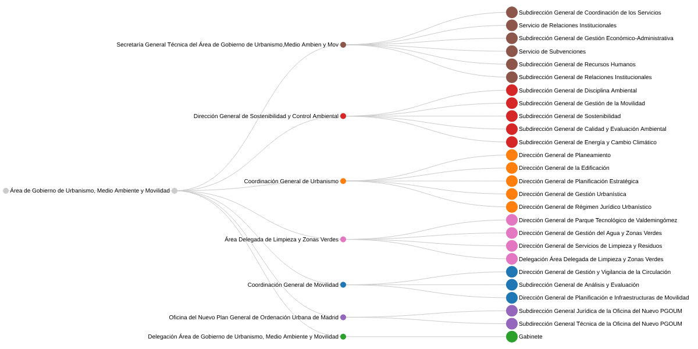

# Técnicas habituales y específicas: Linear dendrogram

**Fuente de los datos**: https://datos.madrid.es/dataset/795391-0-organigrama-del-ayuntamiento-de-madrid-y-sus-organismos-autonomos

**Descripción**: Dataset del organigrama de la ayuntamiento de Madrid

**Visualización**

## Definición general de la técnica: nombre, origen, descripción, funcionamiento y ejemplos típicos de aplicación

El dendrograma es un diagrama en árbol que muestra cómo se organizan elementos de forma jerárquica. Un nodo raíz da origen a varios nodos conectados por ramas, y los nodos finales se llaman hojas.

Existen dos variantes según el origen de los datos: 
1. para datos jerárquicos explícitos, como un organigrama
2. para representar los resultados de un algoritmo de clustering, donde la longitud de las ramas indica la distancia entre grupos.

La herramienta utilizada para la visualización, RAWGraphs, solo permite el dendrograma para datos jerárquicos y no para clustering.

Puede dibujarse en horizontal, vertical, lineal o circular. La versión lineal horizontal es la más adecuada cuando las etiquetas son largas, como ocurre con nombres de unidades administrativas.

**Fuentes**:
- From Data to Viz: https://www.data-to-viz.com/graph/dendrogram.html
- RawGraphs: https://www.rawgraphs.io/learning/how-to-make-a-linear-dendrogram
- Data Viz Project: https://datavizproject.com/data-type/dendrogram/

## Tipo y estructura de datos

El dendrograma representa datos jerárquicos, en los que cada elemento depende de uno y solo uno de nivel superior. Los componentes son variables cualitativas nomilales. No requieren ninguna variable cuantitativa, pero si existe puede usarse para el tamaño de los nodos.

Además, los datos deben formar un árbol estricto con una única raíz, sin ciclos y sin elementos que dependan de dos padres a la vez. 

El dendrograma lineal está limitado, sobre todo, por el número de hojas, porque cada una ocupa una línea de texto en el eje vertical y la profundidad también es limitada. Además, las etiquetas largas, muy frecuentes en datos administrativos, consumen mucho margen, lo que obliga a reservar espacio a la derecha o a abreviar nombres.

El conjunto elegido cumple estos requisitos: es un árbol estricto de 3 niveles con una sola raíz, 7 nodos intermedios y 26 hojas. Limitar la profundidad a dos niveles por debajo del Área de Gobierno fue precisamente una decisión para mantener el gráfico dentro de los márgenes de legibilidad.

## Comentario sobre la visualización

He visualizado la estructura del Área de Gobierno de Urbanismo, Medio Ambiente y Movilidad del Ayuntamiento de Madrid. Los datos se filtraron con pandas en tres niveles. El color identifica cada rama de nivel uno, para diferenciar entre las dependencias de cada una.

En cuanto a la estructura de los datos, RAWGraphs exige una columna por nivel. El dataset original se procesó para convertirlo a este tipo de distribución. Se filtró por el Área de Gobierno y se reestructuró en las columnas `nivel_0`, `nivel_1` y `nivel_2`.

El gráfico permite ver de un vistazo el peso relativo de cada rama, por el número de dependencias que tiene.

El dendrograma funciona bien aquí porque transforma una tabla, más difícil de interpretar, en una visualización que comunica de forma natural la jerarquía.

La audiencia objetivo es personal municipal o ciudadanía interesada en conocer la estructura administrativa.