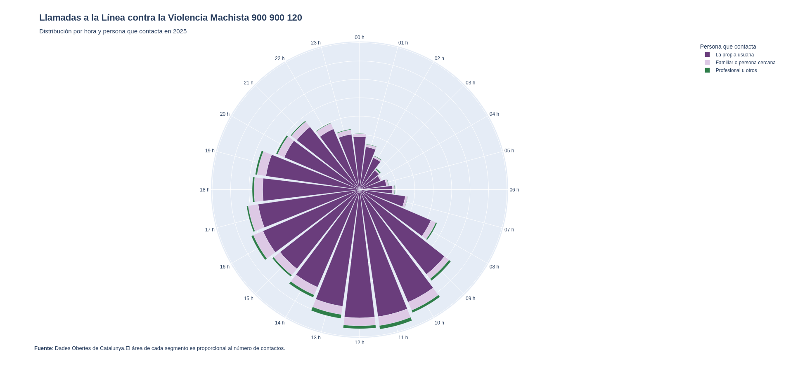

# Técnicas menos habituales o más específicas: Rose Chart

**Fuente de los datos**: https://analisi.transparenciacatalunya.cat/Societat-benestar/L-nia-d-atenci-contra-la-viol-ncia-masclista-900-9/q2sg-894k

**Descripción**: Datos de las llamadas que se reciben en el teléfono 900 900 120 de atención contra la violencia machista, desde 2013 al 21 de octubre de 2026.

**Visualización**:

[Visualización interactiva](plots/rose_chart.html)

## Definición general de la técnica: nombre, origen, descripción, funcionamiento y ejemplos típicos de aplicación

El Rose Chart, Nightingale Rose Chart o Polar Area Chart, recibe su nombre de Florence Nightingale, que lo usó para mostrar las muertes de soldados en la guerra de Crimea.

Se construye en coordenadas polares: cada categoría ocupa un sector del mismo ángulo, y la distancia al centro representa el valor. 

Fuentes:
https://datavizcatalogue.com/methods/nightingale_rose_chart.html
https://datavizproject.com/data-type/polar-area-chart/

## Tipo y estructura de datos

Es una técnica adecuada para fenómenos cíclicos como meses, días u horas, donde hay esta variable cualitativa cíclica, una variable cuantitativa a comparar y, opcionalmente, una segunda cualitativa, una categoría para los segmentos que se apilan en cada área.

Con muchas categorías se vuelve ilegible y con pocas o no cíclicas no tiene sentido, más que estético.

## Comentario sobre la visualización

He representado los contactos a la línea contra la violencia machista en Catalunya durante 2025. Cada sector es una hora del día, apilado en función de quién contacta: la propia usuaria, familiares o profesionales.

¿Qué se ve en los datos? Las llamadas se concentran por la mañana (de 8-14h), no para en ninguna hora del día y la usuaria es siempre mayoritaria entre la persona que contacta. Las llamadas de profesionales son más frecuentes por las mañanas y las de familiares por la tarde.

Este tipo de gráfico funciona bien aquí porque representa la naturaleza circular horaria, de las 23h. se para a las 00h. de forma natural. La orientación como reloj (clockwise) facilita la lectura. 

Aquí utilizo el área y no el radio para facilitar la comparación. Sin ella los valores grandes se exageran visualmente y los pequeños se minimizan, como en el caso de los [gráficos de burbuja](https://www.data-to-viz.com/graph/bubble.html).

El diagrama original de Florence Nightingale tenía esto en cuenta y el área de cada sector era proporcional al número de muertes, no el radio, para facilitar la comparación visual.

Plotly no incluye un método específico para ello, así que hay que preparar los datos con pandas previamente (usando `np.sqrt()`).

Los colores se basan en el violeta, característico del tema, y se complementan con el verde, para distinguir a los profesionales sociosanitarios.